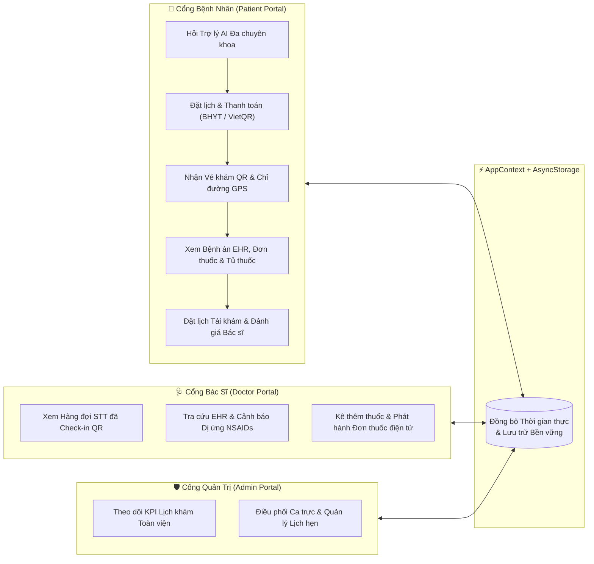

# 🏥 SmartClinic — Hệ Sinh Thái Đặt Lịch Khám, Bệnh Án Điện Tử (EHR) & Trợ Lý Y Khoa AI Đa Nền Tảng

> **Đồ án môn học:** Phát Triển Ứng Dụng Đa Nền Tảng (Cross-Platform Mobile Development)  
> **Nền tảng:** iOS & Android (Expo SDK 58 • React Native 0.88 • TypeScript 6.0 Strict Mode)  
> **Chuẩn chất lượng:** `npx tsc --noEmit` (**0 lỗi**) • `npx expo lint` (**0 errors / 0 warnings**) • Chuẩn trợ năng **WCAG AA** (`>= 5.45:1`) & Vùng chạm y tế **`>= 44×44pt`**

---

## 🌟 1. Giới Thiệu Tổng Quan

**SmartClinic** là ứng dụng y tế số đa nền tảng (iOS/Android) được thiết kế chuyên biệt cho quy trình khám chữa bệnh tại các bệnh viện tuyến cuối ở Việt Nam (**BV Đại học Y Dược TP.HCM**, **BV Chợ Rẫy**, **BV Mắt TP.HCM**, **BV Đa khoa Quốc tế Vinmec**).

Khác với các ứng dụng đặt lịch đơn thuần chỉ dừng ở bước lấy số thứ tự, **SmartClinic** kết nối **đồng bộ 2 chiều theo thời gian thực** giữa **3 vai trò (`Bệnh nhân` ⇄ `Bác sĩ điều trị` ⇄ `Quản trị viên Admin`)** trên cùng một hệ thống, giải quyết trọn vẹn hành trình trước – trong – và sau khi khám:

1. **Trước khi khám:** Sàng lọc triệu chứng đa chuyên khoa với **Trợ lý AI 24/7** (tự động nhận diện dấu hiệu cấp cứu `115` và cảnh báo dị ứng thuốc trong hồ sơ), chọn khung giờ khám, giữ chỗ đối chiếu **BHYT (VssID/CCCD gắn chip)** hoặc thanh toán trực tuyến (**VietQR 24/7, VNPAY-QR, Ví MoMo**), và dẫn đường GPS tới đúng cổng vào / hầm gửi xe bệnh viện.
2. **Trong khi khám:** Nhận phiếu hẹn QR Check-in (`#SC-...`), theo dõi hàng đợi số thứ tự trực tiếp, tư vấn từ xa với bác sĩ chuyên khoa và xem kết quả Chẩn đoán hình ảnh (MRI/X-Quang) & Xét nghiệm máu.
3. **Sau khi khám:** Nhận **Đơn thuốc điện tử** do bác sĩ phát hành tức thì, theo dõi **Nhật ký nhắc uống thuốc**, quản lý **Tủ thuốc gia đình**, đặt lịch tái khám 1 chạm và gửi đánh giá bác sĩ.

---

## 🏗️ 2. Kiến Trúc Hệ Thống & Công Nghệ (Tech Stack)

| Thành phần | Công nghệ / Giải pháp áp dụng |
| :--- | :--- |
| **Core Framework** | **Expo SDK 58** + **React Native 0.88** (New Architecture enabled) |
| **Ngôn ngữ** | **TypeScript 6.0** (`strict: true`, kiểm tra kiểu tĩnh 100%) |
| **Code Quality & Linter** | **ESLint 9** + `eslint-config-expo@~58.0.4` (Chuẩn React Compiler Hooks — **0 errors, 0 warnings**) |
| **Quản lý Trạng thái** | **React Context (`AppContext`)** đồng bộ tức thì giữa 3 cổng `Patient` ⇄ `Doctor` ⇄ `Admin` |
| **Lưu trữ Offline-First** | **`@react-native-async-storage/async-storage`** tự động lưu & khôi phục (`hydrate`) toàn bộ lịch hẹn, đơn thuốc, tủ thuốc, hồ sơ người thân và đánh giá bác sĩ |
| **Tầng Dịch vụ & Bảo mật** | **`src/services/apiClient.ts`** (JWT Access/Refresh Session, `AbortController` timeout, Offline Fallback) + **PII Masking** ẩn số CCCD/BHYT mặc định |
| **Tích hợp Thiết bị (Native)** | Deep Linking **Google Maps / Apple Maps** (`src/utils/mapNavigation.ts`), **OS Native Share Sheet** (`src/utils/shareUtils.ts`), Gọi khẩn cấp Cấp cứu `115` (`tel:115`) |
| **Hệ thống Thiết kế (UI/UX)** | **Clinical Sanctuary Design System** (`src/theme/index.ts`), `Animated` API 60 FPS (`useNativeDriver: true`, `Operate Mode <= 220ms`), độ tương phản chữ đạt chuẩn **WCAG AA** cho bệnh nhân lớn tuổi |

### Sơ đồ Luồng Đồng Bộ 3 Vai Trò (`Patient` ⇄ `Doctor` ⇄ `Admin`)



---

## 📂 3. Cấu Trúc Thư Mục Dự Án

```text
SmartClinic/
├── App.tsx                                    # Điều hướng trung tâm, quản lý Role, Tab & luồng Đặt lịch
├── app.json                                   # Cấu hình Expo SDK 58 (iOS, Android, Web)
├── eslint.config.js                           # Cấu hình ESLint 9 chuẩn Expo
├── UX_AUDIT.md                                # Báo cáo kiểm toán & nâng cấp UX/UI y tế (Đợt 1 -> Đợt 3)
└── src/
    ├── components/
    │   ├── common/                            # Hệ thống Component nền tảng
    │   │   ├── Animations.tsx                 # AnimatedEntry, PressableScale, PulsingDot, Skeletons
    │   │   ├── AppButton.tsx, AppInput.tsx    # Nút bấm (>= 44pt) & Ô nhập liệu có kiểm tra lỗi
    │   │   ├── Badge.tsx, Feedback.tsx        # Huy hiệu lâm sàng, EmptyState, ToastBanner
    │   │   └── SegmentedControl.tsx           # Thanh chuyển tab & chip lọc có trợ năng
    │   ├── medical/                           # Các Component nghiệp vụ Y khoa
    │   │   ├── AIHeroBanner.tsx               # Banner AI gọn nhẹ & Thẻ trích xuất kết luận bác sĩ
    │   │   ├── AIChatComponents.tsx           # Bong bóng chat AI, Thẻ gợi ý Chuyên khoa & Cấp cứu 115
    │   │   ├── AppointmentCard.tsx            # Thẻ lịch hẹn phân cấp trạng thái & Xác nhận hủy lịch
    │   │   ├── DateTimeSlotPicker.tsx         # Bộ chọn Ngày/Giờ khám động theo thời gian thực
    │   │   ├── DoctorCard.tsx                 # Thẻ thông tin Bác sĩ chuyên khoa
    │   │   ├── HospitalCard.tsx               # Thẻ bệnh viện kèm nút mở Bản đồ
    │   │   ├── HospitalMapModal.tsx           # Bản đồ Radar & Dẫn đường Google Maps (Xe máy/Ô tô/Đi bộ)
    │   │   ├── PatientEHRCard.tsx             # Thẻ định danh CCCD & VssID BHYT (tích hợp PII Masking)
    │   │   ├── PrescriptionCard.tsx           # Thẻ Đơn thuốc điện tử, Xét nghiệm & Lịch sử khám
    │   │   └── SpecialtyGrid.tsx              # Lưới chuyên khoa y tế
    │   └── navigation/
    │       ├── AppHeader.tsx                  # Header ứng dụng & Chuông thông báo y tế
    │       └── BottomTabBar.tsx               # Thanh điều hướng 5 tab chính (Trang chủ, Hồ sơ, Lịch khám, Hỏi AI, Cá nhân)
    ├── context/
    │   └── AppContext.tsx                     # Global State + AsyncStorage Persistence
    ├── data/
    │   └── mockData.ts                        # Dữ liệu lâm sàng & hàm sinh ngày động formatRelativeDate()
    ├── screens/
    │   ├── AuthScreens.tsx                    # SplashScreen, LoginScreen (3 vai trò), RegisterScreen
    │   ├── BookingFlowScreens.tsx             # DoctorDetailScreen, BookingSlotScreen, BookingPaymentScreen
    │   ├── MainTabScreens.tsx                 # 5 màn hình chính của Bệnh nhân + Modal Thông báo
    │   ├── PharmacyAndMedicationScreens.tsx   # MedicationLogScreen, PrescriptionDetailScreen, FamilyMedicineCabinetScreen
    │   ├── RoleDashboards.tsx                 # AdminDashboardScreen & DoctorDashboardScreen
    │   └── TelehealthAndFamilyScreens.tsx     # BookingSuccessScreen, TeleconsultationScreen, PostConsultSummaryScreen, FamilyProfilesScreen, LabAndImagingResultsScreen
    ├── services/
    │   └── apiClient.ts                       # HTTP Client, JWT Session & Offline-First Storage Service
    ├── theme/
    │   └── index.ts                           # Hệ thống Design Tokens (COLORS, TYPOGRAPHY, SPACING, TOUCH)
    └── utils/
        ├── mapNavigation.ts                   # Mở Google Maps / Apple Maps & Gọi điện thoại bệnh viện
        └── shareUtils.ts                      # Xuất & Chia sẻ Phiếu hẹn / Đơn thuốc qua Zalo, Email, SMS
```

---

## 🚀 4. Hướng Dẫn Cài Đặt & Chạy Ứng Dụng

### Yêu cầu môi trường
- **Node.js** `>= 18.x`
- Ứng dụng **Expo Go** trên điện thoại iOS/Android, hoặc máy ảo **Android Studio / Xcode**, hoặc trình duyệt Web.

### Các bước khởi chạy
```bash
# 1. Cài đặt dependencies chuẩn Expo SDK
npx expo install

# 2. Khởi chạy máy chủ phát triển (quét mã QR bằng Expo Go hoặc nhấn 'a' cho Android, 'w' cho Web)
npx expo start
```

### Kiểm tra chất lượng mã nguồn (Typecheck & Lint)
```bash
# Kiểm tra kiểu dữ liệu TypeScript (0 lỗi)
npx tsc --noEmit

# Kiểm tra quy chuẩn code ESLint Expo (0 errors, 0 warnings)
npx expo lint
```

---

## 🔑 5. Tài Khoản Thử Nghiệm 3 Vai Trò (Role Presets)

Trên màn hình **Đăng nhập**, ở chế độ phát triển (`__DEV__`), bạn có thể chạm vào thanh **`[DEV] Chuyển nhanh vai trò thử nghiệm`** để tự động điền thông tin hoặc nhập trực tiếp các email sau:

| Vai trò | Email đăng nhập | Mật khẩu mẫu | Chức năng chính |
| :--- | :--- | :--- | :--- |
| 👤 **Bệnh nhân** | `vu.nguyen@smartclinic.vn` | `••••••••` | Đặt lịch khám, Hỏi AI, Xem EHR, Tủ thuốc, Hồ sơ gia đình |
| 🩺 **Bác sĩ điều trị** | `bs.trang@smartclinic.vn` | `••••••••` | Quản lý hàng đợi STT, Xem EHR bệnh nhân, Kê đơn thuốc điện tử |
| 🛡️ **Quản trị viên (Admin)** | `admin@smartclinic.vn` | `••••••••` | Giám sát KPI toàn viện, Điều phối lịch hẹn & danh sách bác sĩ |

---

## 🎬 6. Kịch Bản Trình Diễn Bảo Vệ Đồ Án Cuối Kỳ (5 Phút)

Dưới đây là kịch bản demo mạch lạc đi qua trọn vẹn các điểm sáng kỹ thuật và UX của **SmartClinic**:

### ⏱️ Phút 1: Sàng lọc triệu chứng bằng AI Đa chuyên khoa & Cảnh báo Y khoa
1. Đăng nhập với vai trò **Bệnh nhân (`Nguyễn Văn Vũ`)**, mở tab **Hỏi AI** (`Trợ lý Sức khỏe AI`).
2. Chạm chip gợi ý **`"Dấu hiệu cần cấp cứu"`** ➔ AI lập tức hiển thị **Thẻ cảnh báo đỏ** kèm nút **`Gọi Cấp Cứu 115 Ngay`**.
3. Chạm chip **`"Thuốc giảm đau tạm thời"`** ➔ AI tự động đối chiếu hồ sơ EHR, cảnh báo bệnh nhân có tiền sử **Dị ứng nhóm NSAIDs (Ibuprofen)** và khuyến cáo không tự ý dùng thuốc kháng viêm.
4. Chạm chip **`"Tức ngực, hồi hộp tim đập nhanh"`** ➔ AI phân tích triệu chứng, gợi ý chuyên khoa **Tim Mạch** và hiển thị thẻ bác sĩ **`BS. CKII. Nguyễn Văn Minh`** ngay trong khung chat.

### ⏱️ Phút 2: Đặt lịch khám, Thanh toán Đa phương thức & Bản đồ Dẫn đường
1. Bấm **`"Đặt lịch khám ngay"`** ngay trên thẻ bác sĩ trong khung chat AI (hoặc chọn từ Trang chủ).
2. Chọn ngày khám (tự động tính động từ ngày hiện tại) và khung giờ khám ➔ Tiếp tục sang **Xác nhận & Thanh toán**.
3. Trình diễn 4 phương thức thanh toán: **Giữ chỗ BHYT tại viện (0đ trả trước)**, **Chuyển khoản VietQR 24/7**, **VNPAY-QR**, **Ví MoMo** ➔ Hoàn tất đặt lịch.
4. Tại màn hình **Đặt lịch thành công**:
   - Bấm **`"Chia sẻ phiếu hẹn"`** để mở Native OS Share Sheet (chia sẻ qua Zalo/Tin nhắn).
   - Bấm **`"Mở bản đồ dẫn đường"`** để xem cổng vào, hầm gửi xe và mở thẳng Google Maps chỉ đường.

### ⏱️ Phút 3: Bảo mật Hồ sơ Bệnh án (PII Masking) & Quản lý Tủ thuốc Gia đình
1. Chuyển sang tab **Hồ sơ (`EHRScreen`)**:
   - Trình diễn tính năng **PII Masking**: Số CCCD (`079201******`) và mã BHYT (`DN4 79 *** 82390`) được che mặc định; bấm nút **`"Hiện mã số"`** để mở khóa khi xuất trình tại quầy.
2. Mở **Tủ thuốc gia đình (`FamilyMedicineCabinetScreen`)**:
   - Bấm **`"+ Thêm thuốc"`**, nhập thêm 1 loại thuốc mới vào tủ thuốc nhà và lọc theo trạng thái **`Sắp hết`** / **`Đủ dùng`**.
3. Mở **Hồ sơ Y tế Gia đình (`FamilyProfilesScreen`)**:
   - Bấm **`"Đặt lịch khám"`** trên hồ sơ của mẹ (`Bà Trần Thị Lan • 62 tuổi`) ➔ Màn hình Thanh toán tự động nhận đúng thông tin người khám là Bà Trần Thị Lan.

### ⏱️ Phút 4: Đồng bộ 2 chiều sang Cổng Bác sĩ (`Doctor Portal`) — Kê đơn & Phát hành
1. Vào tab **Cá nhân** ➔ **Đăng xuất** ➔ Chọn vai trò **`Bác sĩ (TS. BS. Lê Thu Trang)`**.
2. Tại **Cổng Bác sĩ**:
   - Xem hàng đợi bệnh nhân đã đặt lịch từ bước trước.
   - Bấm **`"+ Thêm thuốc vào đơn"`**, nhập thuốc mới và bấm **`"Lưu & Phát hành đơn thuốc"`**.
3. Đăng xuất và quay lại tài khoản **Bệnh nhân**:
   - Mở **Kết quả khám & Đơn thuốc (`PostConsultSummaryScreen`)**: Thuốc bác sĩ vừa kê đã xuất hiện tức thì; bệnh nhân chấm **5 sao**, gửi nhận xét đánh giá bác sĩ và bấm **`"Đặt lịch tái khám"`**.

### ⏱️ Phút 5: Giám sát Điều phối Toàn viện trên Cổng Quản trị (`Admin Portal`) & Persistence
1. Đăng nhập vai trò **`Admin`** ➔ Mở tab **Điều phối lịch (`Appointments`)**:
   - Toàn bộ lịch hẹn mới đặt hiển thị theo thời gian thực; Admin có thể điều phối hoặc hủy lịch ngay trên bảng điều khiển.
2. Tắt và mở lại ứng dụng (Reload) để chứng minh toàn bộ dữ liệu vừa thao tác được lưu bền vững 100% nhờ **`AsyncStorage`**.

