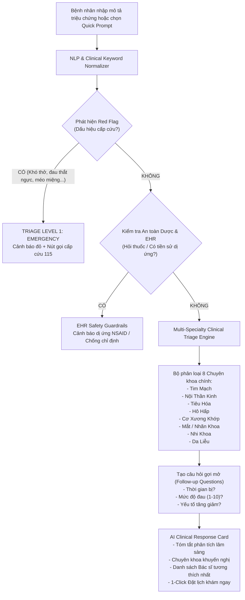

# KIẾN TRÚC & ĐẶC TẢ HỆ THỐNG TRỢ LÝ Y TẾ AI CHO BỆNH NHÂN (MEDICARE PLUS AI PATIENT ASSISTANT)

> **Dự án:** Quản trị Dự án Phần mềm - MediCare Plus (VKU SPM Capstone)  
> **Tác giả phụ trách:** Vi Hữu Thành (`thanhvihuu2005`)  
> **Mục tiêu:** Xây dựng hệ thống trợ lý ảo AI hỗ trợ bệnh nhân sàng lọc triệu chứng, phân luồng cấp cứu, tư vấn chuyên khoa và điều hướng đặt khám bác sĩ chuẩn xác 24/7.

---

## 1. KHẢO SÁT & ĐỐI SÁNH CÁC GIẢI PHÁP MEDICAL AI TRÊN THẾ GIỚI

Để xây dựng một mô hình AI y tế phục vụ bệnh nhân chuẩn mực, đáng tin cậy và tuân thủ nguyên tắc an toàn lâm sàng, nhóm đã tiến hành khảo sát và chắt lọc kinh nghiệm từ 4 giải pháp tiêu biểu hàng đầu:

| Giải pháp | Cơ chế cốt lõi | Ưu điểm nổi bật | Điểm ứng dụng vào MediCare Plus |
| :--- | :--- | :--- | :--- |
| **Ada Health** (Đức) | Bayesian Network + Medical Knowledge Graph | Đặt câu hỏi khai thác bệnh sử sâu từng bước (multi-turn questionnaire), tính xác suất bệnh lý. | Thiết kế bộ câu hỏi gợi mở đào sâu triệu chứng (thời gian bị, mức độ đau, triệu chứng kèm theo). |
| **Babylon Health** (Anh) | Clinical Decision Support System (CDSS) | Phân tầng mức độ khẩn cấp (Triage Urgency: Cấp cứu vs Khám trong 24h vs Chăm sóc tại nhà). | Áp dụng thang đo mức độ khẩn cấp (Emergency / Urgent / Routine / Self-care) theo chuẩn phân luồng ESI. |
| **Buoy Health** (Mỹ) | Natural Language Clinical Reasoning | Nhận diện "Red Flags" (cờ đỏ nguy kịch) để cảnh báo tức thì, ngăn bệnh nhân tự dùng thuốc nguy hiểm. | Hệ thống phát hiện dấu hiệu cảnh báo đỏ (khó thở, tức ngực, méo miệng đột quỵ) và kích hoạt CTA gọi 115. |
| **Vinmec AI / MyVinmec** (Việt Nam) | Tích hợp EHR Bệnh nhân & Đặt khám chuyên khoa | Gợi ý đích danh bác sĩ phù hợp theo triệu chứng và kết nối trực tiếp vào luồng đặt lịch khám. | Kết nối liền mạch với danh sách bác sĩ thực tế của hệ thống MediCare Plus, lọc theo chuyên khoa gợi ý. |

---

## 2. KIẾN TRÚC TỔNG THỂ (AI PATIENT ASSISTANT ARCHITECTURE)

---

## 3. CÁC CẤP ĐỘ PHÂN LUỒNG KHẨN CẤP (CLINICAL TRIAGE LEVELS)

Hệ thống phân luồng dựa trên tiêu chuẩn phân loại cấp cứu quốc tế (Emergency Severity Index - ESI & Manchester Triage):

1. **Level 1 - Emergency (Cấp cứu khẩn cấp - Đỏ):**
   - *Triệu chứng:* Khó thở dữ dội, đau ngực trái lan lên cằm/tay, yếu liệt nửa người, méo miệng, co giật, ngất xỉu, sốt cao co giật ở trẻ em.
   - *Hành động hệ thống:* Bật khung cảnh báo màu đỏ chớp nhẹ, thông báo khẩn cấp và hiển thị nút **Gọi Cấp cứu 115 ngay lập tức**, không khuyến khích tự điều trị tại nhà.
2. **Level 2 - Urgent (Khám sớm trong 24h - Cam):**
   - *Triệu chứng:* Đau bụng quặn dữ dội, sốt cao > 39 độ liên tục 2 ngày, đau nửa đầu dữ dội kèm buồn nôn, đau lưng lan tê buốt xuống chân.
   - *Hành động hệ thống:* Gợi ý chuyên khoa khám khẩn cấp trong ngày, ưu tiên đặt lịch với bác sĩ đầu ngành có lịch trống gần nhất.
3. **Level 3 - Routine (Khám định kỳ / Chuyên khoa - Xanh dương):**
   - *Triệu chứng:* Mỏi mắt do làm việc máy tính, mẩn ngứa da nhẹ, ho khan thoáng qua, viêm mũi xoang mạn tính.
   - *Hành động hệ thống:* Phân tích nguyên nhân có thể, hướng dẫn biện pháp sơ cứu/chăm sóc ban đầu và đề xuất bác sĩ chuyên khoa phù hợp.
4. **Level 4 - Self-Care & Lifestyle (Tự chăm sóc & Dinh dưỡng - Xanh lá):**
   - *Mục đích:* Hỏi về chế độ kiêng cữ, sinh hoạt, tập luyện, bổ sung dinh dưỡng, theo dõi sức khỏe tại nhà.
   - *Hành động hệ thống:* Cung cấp hướng dẫn chăm sóc y tế tại nhà chuẩn khoa học kèm lời khuyên theo dõi diễn tiến triệu chứng.

---

## 4. AN TOÀN LÂM SÀNG & TÍCH HỢP HỒ SƠ SỨC KHỎE (EHR GUARDRAILS)

- **Cảnh báo Dị ứng Thuốc:** Tích hợp trực tiếp dữ liệu từ hồ sơ bệnh nhân (Patient Profile / EHR). Ví dụ: Bệnh nhân có tiền sử dị ứng nhóm NSAID (Ibuprofen, Aspirin), khi hỏi về thuốc giảm đau đầu hoặc đau nhức xương khớp, AI tự động kích hoạt cảnh báo đỏ, nghiêm cấm tự mua thuốc NSAID và gợi ý biện pháp thay thế an toàn.
- **Tuyên bố Miễn trừ Trách nhiệm Y tế (Medical Disclaimer):** Toàn bộ kết quả tư vấn đều gắn kèm thông báo pháp lý: *"Kết quả phân tích từ AI chỉ mang tính chất tham khảo định hướng chuyên khoa, không thay thế chẩn đoán lâm sàng của bác sĩ chuyên môn"* (Tuân thủ Thông tư 54/2017/TT-BYT và chuẩn SaMD).
